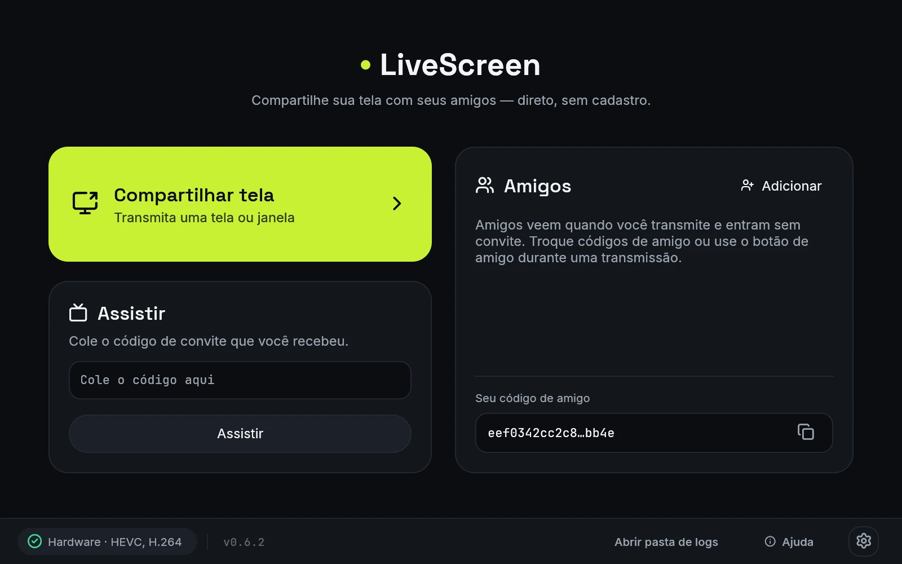
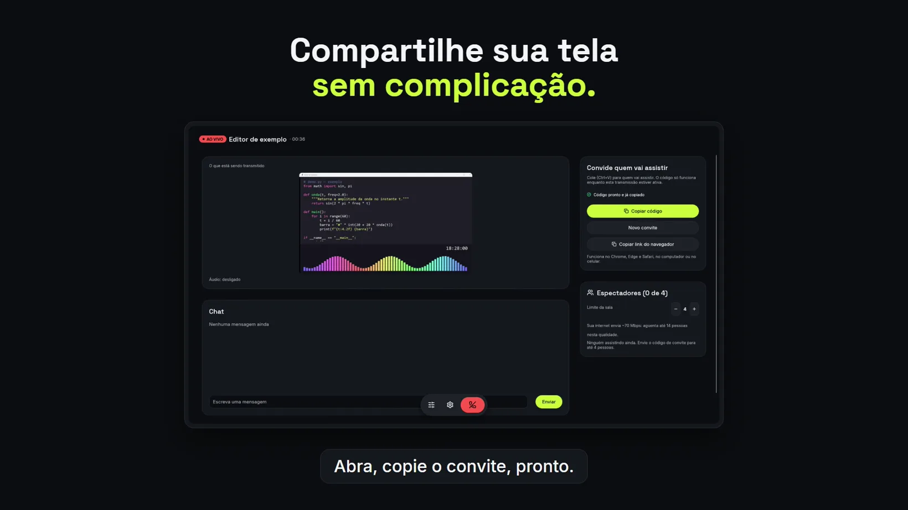
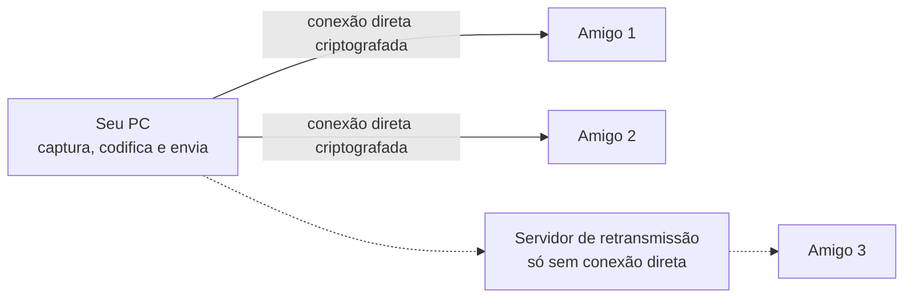
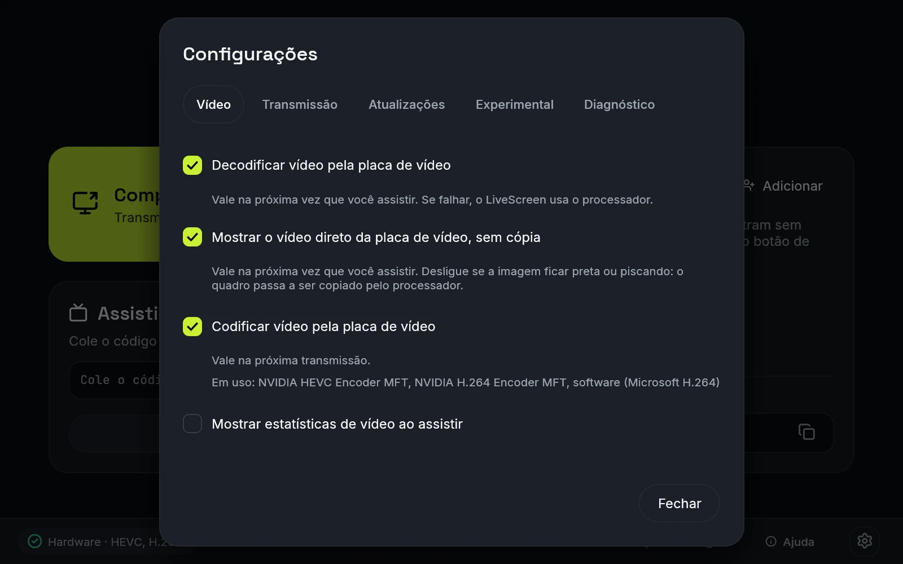

<div align="center">


# LiveScreen

**Compartilhe a tela do Windows com seus amigos, direto de um PC para o outro.**<br>
Sem cadastro e sem servidor de vídeo no meio: quem assiste só precisa do LiveScreen e de um código de convite.

[](https://github.com/pendiego/LiveScreen/releases/latest)
[](https://github.com/pendiego/LiveScreen/actions/workflows/ci.yml)

[](#licença)

**[Baixar o livescreen.exe](https://github.com/pendiego/LiveScreen/releases/latest/download/livescreen.exe)** · [todas as versões](https://github.com/pendiego/LiveScreen/releases) · [site](https://pendiego.github.io/LiveScreen/)



<a href="https://pendiego.github.io/LiveScreen/assets/video/livescreen-v0.6.0.mp4"></a>

▶ **[Assista ao vídeo de lançamento da 0.6](https://pendiego.github.io/LiveScreen/assets/video/livescreen-v0.6.0.mp4)** (45 s)<br>
<sub>Vídeo feito com o Claude Opus 5.5.</sub>

</div>

## Como usar

<table>
<tr>
<th width="50%">Para compartilhar</th>
<th width="50%">Para assistir</th>
</tr>
<tr>
<td valign="top">

1. Clique em **Compartilhar tela**.
2. Clique na tela ou janela que quer mostrar.
3. Confira a qualidade e o áudio no popup e clique em **Iniciar transmissão**.
4. O código de convite já vai para a área de transferência: cole (Ctrl+V) no chat para quem vai assistir.

</td>
<td valign="top">

1. Copie o código que recebeu.
2. Cole no campo **Assistir** da tela inicial e clique em **Assistir** (ou Enter): conecta direto.
3. Com o campo vazio, **Assistir** abre a tela de convite com o código da área de transferência já preenchido; clique em **Conectar**.

Amigos na lista entram sem convite: o botão **Assistir** aparece na linha do amigo só enquanto ele está transmitindo.

</td>
</tr>
</table>

Durante a transmissão dá para trocar a qualidade, mudar o limite de pessoas da sala e remover alguém sem derrubar os outros. A janela do LiveScreen some da própria transmissão, então ela não aparece para quem assiste.

## Como funciona



Cada pessoa que assiste recebe do seu PC a própria cópia do vídeo e do áudio. Quando a conexão direta não é possível, os pacotes passam por um servidor de retransmissão, que só repassa dados criptografados de ponta a ponta.

> [!NOTE]
> O servidor de retransmissão padrão é a infraestrutura pública e gratuita da n0 (equipe do iroh). Ela é compartilhada com outros apps, [feita para desenvolvimento e testes e tem limite de taxa](https://docs.iroh.computer/add-a-relay). Com conexão direta, nada passa por ela. Quando alguém aparece como **Via servidor**, qualidades altas podem travar: baixe a qualidade da transmissão ou peça uma mais leve no menu **Qualidade** de quem assiste.

## Qualidade, sala e internet

Quem limita o tamanho da sala é o **upload** da sua internet:

| Qualidade | Upload por pessoa (máximo, com muito movimento) |
|---|---|
| 480p 30fps | 1,5 Mbps |
| 720p 30fps | 4 Mbps |
| 1080p 60fps | 8 Mbps |

> [!TIP]
> Telas paradas (slides, código, navegador) gastam bem menos que isso.

Para ajudar na escolha:

- **Upload medido:** ao abrir a escolha de tela, o app mede o seu upload (~5 s) e mostra quantas pessoas cada qualidade aguenta.
- **Qualidade recomendada:** o app marca a mais pesada que o seu PC e a sua internet sustentam para o tamanho da sala, até 1080p 60fps.
- **Limite da sala:** começa em 4 pessoas e pode ser aumentado durante a transmissão. Se o limite passar do que a internet aguenta, aparece um aviso. Quem tenta entrar com a sala cheia recebe "Recusado: sala cheia".
- **Opções conforme a fonte:** só aparecem as que cabem na tela ou janela escolhida, das maiores para as menores (a mesma ordem vale para a qualidade padrão nas Configurações e para o menu **Qualidade** de quem assiste, no desktop e no navegador). Por enquanto a transmissão vai até 1080p 60fps, mesmo em monitores maiores ou acima de 60 Hz.
- **PC sobrecarregado:** se o computador não der conta da qualidade, o app avisa e, com "Baixar a qualidade sozinho" ligado (padrão), reduz uma faixa sozinho, no máximo a cada 10 s. Só reduz, e só por sobrecarga do PC; a rede continua só com o bitrate adaptativo. Trocas de qualidade ou codec rodam em segundo plano e não travam a janela.
- **Sem custo de servidor:** não há servidor de vídeo para pagar. Cada pessoa recebe a própria cópia, então o upload necessário é o valor da tabela vezes o número de pessoas. Para caber mais gente, baixe a qualidade ou o limite da sala.
- **Leve para quem assiste:** o codec é escolhido automaticamente entre os que todos na sala decodificam. HEVC e AV1 só entram se todo mundo os decodifica pela placa de vídeo; senão vai H.264. O navegador entra no AV1 quando decodifica AV1 pela placa (hosts anteriores mandam só H.264 ao navegador). Se o PC ou o celular de quem assiste esquentar ou travar, peça uma qualidade mais leve no menu **Qualidade**.

## Recursos

| Recurso | Como funciona |
|---|---|
| **Captura** | Windows Graphics Capture, de tela inteira ou janela. Para telas inteiras, há fallback para DXGI Desktop Duplication, que no Windows 10 é o padrão para telas (sem a borda amarela do WGC) e desenha o cursor. Com o HDR do Windows ligado, a captura converte para SDR na placa de vídeo usando o "Brilho do conteúdo SDR" do Windows, sem cores lavadas para quem assiste. |
| **Vídeo** | Codificação H.264, HEVC e AV1 por hardware (NVIDIA, AMD ou Intel, via Media Foundation), negociados automaticamente entre os participantes, com fallback para codificação H.264 por software. Limitado ao nível 5.2 no H.264: lado de até 4096 px, e a "Nativa" é reduzida quando passa disso. Telas ultrawide e em pé mantêm a área de imagem da qualidade escolhida, sem virar faixa fina. |
| **Áudio** | Opus, com todo o som do computador (tela) ou só o do aplicativo (janela), e o microfone opcional (desligado por padrão, com escolha do dispositivo ao iniciar ou em Configurações > Áudio, onde também se escolhe a saída de quem assiste), mixados num só stream. |
| **Conexão** | Direta entre os PCs via [iroh](https://iroh.computer), com servidor de retransmissão quando a conexão direta não é possível. A conexão é criptografada de ponta a ponta. |
| **Rede** | Controle de congestionamento BBR e bitrate adaptativo: quando a fila de algum espectador cresce, o bitrate cai na hora e volta aos poucos até o teto da qualidade. Com o bitrate abaixo da metade do teto, o host corta o fps (metade, depois um quarto) e mantém a resolução, para o texto continuar nítido. Vídeo atrasado é descartado em vez de acumular. Quando a tela para, o último quadro é reenviado algumas vezes para o encoder refinar o que saiu borrado no movimento. |
| **Atualização** | Pelo próprio app, com conferência do arquivo baixado. |
| **Interface** | Tema escuro único "Sinal" (verde-limão sobre grafite), com as fontes Space Grotesk, Inter e JetBrains Mono embutidas e ícones Lucide, anel de foco verde-limão para navegar pelo teclado e nomes acessíveis nos botões só com ícone. Quando as animações estão desligadas no Windows, o app desativa as animações de transição e de rolagem; os indicadores de carregamento continuam girando. |
| **Tela cheia (desktop)** | Ao conectar, o viewer do PC abre em tela cheia. `F11` ou o botão da barra alternam, `Esc` sai da tela cheia e **Sair** volta à Home. |
| **Navegador** | "Copiar link do navegador" gera um link para assistir sem instalar nada. A página usa o tema Sinal e mostra cada etapa (conectando, esperando o host aceitar, recebendo vídeo, sinal instável, encerrado, com "Tentar de novo" nos erros). O player tem selo AO VIVO com tempo, painel de estatísticas (resolução, fps, taxa, perda, latência e caminho direto, IPv4 ou IPv6), chat, mudo, Picture-in-Picture e tela cheia, com controles que somem sozinhos e atalhos `M`, `P`, `I`, `F` e `C` (chat). O chat abre numa coluna ao lado do vídeo, como na Twitch; no celular em pé desce para baixo do vídeo, e no celular deitado volta para o lado. Ele fecha pelo X do cabeçalho, pelo `C` ou por `Esc` no campo de mensagem, e a tela cheia leva vídeo e chat juntos. Ao abrir o link, a chave da sala sai da barra de endereço e fica só na aba (recarregar continua funcionando). A página tem CSP e cabeçalhos que impedem embutir em outro site, e não carrega script de terceiros. Se a sinalização cair (queda de rede de quem transmite ou atualização do servidor do link), quem já está assistindo continua vendo e conversando. Se a conexão com quem transmite cair (troca entre Wi-Fi e dados móveis, por exemplo), a página reconecta sozinha até 5 vezes, mantendo a última imagem na tela; saída pelo host (fim, remoção, sala cheia) não reconecta. No Chrome e no Edge, o Picture-in-Picture abre uma janela flutuante com vídeo e chat, e pode abrir sozinho ao trocar de aba; a transmissão aparece nos controles de mídia do sistema, e a tela cheia no celular gira para paisagem quando o vídeo é horizontal. Abrindo a página sem link, dá para colar o link inteiro ou só o código (`sala.chave.impressão.v3` ou, de hosts antigos, `sala.chave`); com uma sala já guardada na aba, o botão **Trocar transmissão** esquece a anterior e volta ao campo de colar. Funciona no Chrome, Edge, Firefox e Safari: o Firefox só decodifica H.264 Baseline, então enquanto houver um espectador assim o host codifica a sala em Baseline (o rótulo do encoder mostra "H.264 Baseline (navegador)") e volta ao normal quando ele sai. No celular, com a aba em segundo plano (e sem Picture-in-Picture), a página avisa o host e ele para de mandar o vídeo para ela, economizando dados e bateria; o áudio continua, e a imagem volta em cerca de 1 s ao reabrir a aba. Se uma VPN for a rota padrão do host, o app avisa na tela de transmissão e o link do navegador também tenta pela placa de rede física; se a VPN bloquear o tráfego fora dela, desligue-a. Criptografia do link: ver a linha seguinte. |
| **Segurança do link do navegador** | O link termina em `.v3` e leva no `#` (que não chega ao servidor) uma chave de 256 bits e a impressão digital da chave pública de quem transmite. Para cada espectador, o navegador e o host combinam chaves descartáveis X25519 e ML-KEM-768 (pós-quântica), e com elas cifram o pedido de entrada e a resposta que leva a impressão do DTLS. Quem gravou a sinalização e depois vê o link não consegue abrir nada. Quem tem o link não consegue se passar pelo host para outro espectador. O servidor do link não consegue trocar a chave do host sem que a página recuse. "Novo convite" e remover alguém trocam todas as chaves, e o link antigo para de funcionar. O app copia o convite e o link marcados como sensíveis: no Windows eles ficam fora do histórico (`Win+V`) e da área de transferência na nuvem. O link é a senha da sala: quem o tiver entra. Na conexão direta (P2P), quem assiste vê o IP de quem transmite, e vice-versa. Antes de publicar o link, o host confere a página do espectador contra um manifesto assinado offline pelo mantenedor e não gera o link se a página tiver sido trocada. Nada disso protege contra malware ou extensão no aparelho de quem assiste. |
| **Chat** | Chat de texto na transmissão, no host e em quem assiste (desktop e navegador). Quem assiste manda a mensagem ao host, e o host repassa para a sala toda, inclusive para quem enviou (o eco confirma o envio). Uma linha por mensagem, até 500 caracteres, no máximo 5 em rajada e 2 por segundo por pessoa (o excesso é descartado). Não há histórico para quem entra no meio nem gravação em disco, e não tem horário. Quem assiste aparece como `Nome #N` (o número é atribuído pelo host, então nomes iguais não se confundem), o host leva a marca **anfitrião** e amigos (por chave) levam a marca **amigo**; no navegador não há selo de amigo. Suas próprias mensagens aparecem como "Você". Com o chat fechado, chega um aviso da mensagem nova. Tudo passa pela mesma conexão da transmissão: não há servidor novo nem conexão externa extra. |
| **Avatares** | Cada pessoa escolhe um de 7 bichos desenhados no próprio app (gato, raposa, urso, coelho, sapo, polvo e peixe): no desktop em Configurações → Transmissão e no navegador junto do campo de nome. Sem escolha, o app usa um automático que depende do nome. O avatar aparece no chat, na lista de quem assiste e ao lado do nome de quem transmite. Não há upload de imagem: pela rede só vai o número do avatar, e a escolha fica guardada no aparelho. Versões anteriores ignoram o avatar e mostram o automático. |
| **Doações simuladas (experimental)** | Em Configurações → Experimental, o host liga "Doações simuladas no chat" (vale na próxima transmissão). Quem assiste pelo desktop ou pelo navegador vê botões de moedas fictícias (5, 10, 50, 100) no chat; a doação vira uma linha destacada ("doou N moedas") e host e espectadores recebem um aviso. Nenhum dinheiro de verdade. |

## Configurações

Abra pela engrenagem em qualquer tela ou com `Ctrl+,`: decodificar e codificar pela placa de vídeo, mostrar o vídeo direto da placa de vídeo sem cópia pelo processador, estatísticas de vídeo ao assistir (overlay com fps e ms por quadro), qualidade e áudio padrão, baixar a qualidade sozinho quando o PC não der conta, aceitar pedidos de qualidade de quem assiste, limite da sala, nome, verificação de atualização e backends de captura. Tudo fica em `ui.json`.

<div align="center">

</div>

**Qualidade pelo espectador:** quem assiste (no app ou no navegador, que tem o mesmo menu a partir desta versão do host) pode pedir ao host uma qualidade mais leve (menu "Qualidade"), inclusive as faixas 240p 30, 360p 30 e 480p 15 (hosts mais antigos, que não conhecem essas faixas, recebem 480p 30). No app desktop o menu só lista faixas mais leves que o stream atual (filtro conservador: como o viewer não conhece a fonte do host, pode esconder uma redução válida, mas nunca oferece uma ampliação). O host só aplica se o stream de fato ficar mais leve (largura, altura, fps e bitrate não sobem), no máximo um pedido a cada 5 s, e vale para a sala toda. O host pode desligar os pedidos em Configurações ("Aceitar pedidos de qualidade mais leve de quem assiste"); desligado, eles só aparecem como aviso.

## Requisitos

- **Host (quem transmite):** Windows 10 versão 2004 ou superior, 64 bits.
- **Viewer (quem assiste):** Windows 10 2004+ x64.
- **Versões:** hosts 0.5 a 0.7 aceitam viewers 0.5 a 0.7 (protocolo 5). Viewers 0.5 a 0.7 conectam também a hosts 0.4 (protocolo 4), mas versões com protocolos incompatíveis recusam a conexão com "versão incompatível". O chat exige host e viewer 0.6 ou superior; com uma ponta mais antiga a transmissão funciona normalmente, só sem chat (o botão não aparece). O número do protocolo não mudou na 0.6 nem na 0.7. No navegador, a página é sempre a mais nova: abre os links `.v3` dos hosts 0.7 e continua abrindo os links `.v2` e mais antigos dos hosts 0.6 e anteriores. Hosts 0.7 só aceitam espectadores com link `.v3`.

## Download e atualização

Baixe o `livescreen.exe` (ou o `.zip`) em [Releases](https://github.com/pendiego/LiveScreen/releases). Não precisa instalar: é só abrir.

Ao abrir, o app verifica se há versão nova. Se houver, aparece o botão **Atualizar para a versão X** no rodapé da tela inicial. Ele:

1. baixa a assinatura `livescreen.exe.sig` e o `livescreen.exe` da release;
2. confere o sha256 publicado pelo GitHub;
3. confere a assinatura Ed25519 (feita offline pelo mantenedor) sobre a versão e o sha256, com a chave pública embutida no app; sem assinatura válida a release é ignorada;
4. troca o executável e reabre o app.

> [!NOTE]
> Publicação (mantenedor): o CI cria a release como rascunho; `.github/scripts/sign-release.ps1 -Tag vX.Y.Z` baixa o exe, assina com a chave privada local (`%USERPROFILE%\.livescreen-release\update-key.pk8`, fora do repositório), sobe `livescreen.exe.sig` e publica. Enquanto estiver em rascunho, nenhum updater vê a release.

> [!NOTE]
> Para atualizar, o executável precisa estar numa pasta com permissão de escrita (fora de `Program Files`, por exemplo).

### Android (descontinuado)

O app Android foi descontinuado e saiu do repositório: não há APK novo nem atualização. Quem já tem o app instalado continua assistindo hosts desktop (o protocolo é o mesmo). No celular, assista pelo link do navegador.

## Conexões que o app faz

| Destino | Quando | Para quê |
|---|---|---|
| Servidores públicos da n0 (equipe do iroh) | ao transmitir, ao assistir e com o app aberto fora de uma transmissão quando há amigos na lista | Encontrar o outro PC e retransmitir quando não há conexão direta, e ver quais amigos estão transmitindo (uma conexão curta por amigo a cada 15 s). Os servidores repassam pacotes criptografados e não veem o vídeo. É infraestrutura pública compartilhada, para testes e com limite de taxa: não há garantia de banda quando o vídeo passa por ela. |
| `api.github.com` / `github.com` | ao abrir o app; ao clicar em Atualizar | Verificar e baixar versões novas |
| `speed.cloudflare.com` | ao abrir a escolha de tela, uma vez por execução, e ao clicar em "Medir de novo" | Medir o upload. O teste dura ~5 s e envia dados de teste: cerca de 60 MB numa fibra de 100 Mbps, com teto de 150 MB. |
| `livescreen.pendiego.com` (Cloudflare Worker) e `stun.cloudflare.com` | ao clicar em "Copiar link do navegador" durante uma transmissão | Sinalização do espectador no navegador (o offer/answer WebRTC cifrados e a chave pública do host, sem vídeo) e descoberta do endereço público por STUN (o host consulta `stun.cloudflare.com`, `stun.l.google.com`, `global.stun.twilio.com`, `stun.nextcloud.com` e `stun.sipgate.net` a cada espectador do navegador para achar o endereço público e prever portas). O vídeo vai direto do PC para o navegador (WebRTC), sem TURN. Antes de conectar a sinalização (e de novo nas reconexões, no máximo a cada 10 min), o host baixa `/v/manifest.json`, `/v/manifest.json.sig` e os arquivos da página do espectador para conferir a assinatura. |

## Avançado

<details>
<summary><b>Arquivos em <code>%APPDATA%\LiveScreen\</code> e <code>config.json</code></b></summary>

- **`ui.json`:** preferências (qualidade, áudio, nome, volume, limite da sala, posição da janela, decodificação/codificação por hardware, estatísticas, atualização, backends de captura).
- **`livescreen.log`:** registro para diagnóstico.
- **`config.json`** (opcional): desliga partes da captura ou do encoder para contornar problemas de driver:

  ```json
  { "capture_overrides": ["deny-hardware-encoder"] }
  ```

  Os valores aceitos são `deny-graphics-capture`, `deny-dxgi`, `deny-hardware-encoder`, `deny-hardware-decoder` e `deny-zero-copy` (o viewer volta a ler o quadro pela CPU em vez de compartilhar a textura com a placa de vídeo; o overlay de estatísticas mostra `sem cópia` ou `cópia via CPU`). A variável de ambiente `LIVESCREEN_CAPTURE_OVERRIDES` (valores separados por vírgula) substitui o arquivo. O que o arquivo ou a variável desligam não pode ser religado em Configurações. A janela usa o backend DX12 do wgpu; `WGPU_BACKEND` troca o backend e, fora do DX12, o viewer usa a cópia via CPU.

</details>

<details>
<summary><b>Diagnóstico pela linha de comando</b></summary>

O `.exe` é um app de janela: para ver a saída, redirecione, ex.: `livescreen.exe --probe-encoder | Out-String` no PowerShell ou `| more` no cmd.

- `livescreen.exe --probe-encoder`: testa os encoders de placa e imprime o que funcionou;
- `livescreen.exe --selftest-capture`: captura a tela principal por 3 s com cada backend e conta os quadros.

</details>

<details>
<summary><b>Compilar</b></summary>

Requisitos: Rust estável (edição 2024), toolchain MSVC e CMake no `PATH` (usado para compilar o Opus).

```powershell
cargo build --release
.\target\release\livescreen.exe
```

O `build.rs` embute o ícone no `.exe` sem precisar de `rc.exe`.

</details>

<details>
<summary><b>Testes</b></summary>

```powershell
cargo test
```

Testes manuais (`#[ignore]`), que usam GPU e janelas reais:

```powershell
cargo test --release codec_roundtrip -- --ignored --nocapture   # codifica e decodifica na GPU
cargo test --release e2e_window -- --ignored --nocapture        # transmite uma janela tkinter; exige python com tkinter no PATH
```

</details>

## Licença

Dual: [MIT](LICENSE-MIT) ou [Apache-2.0](LICENSE-APACHE), à sua escolha.

As fontes [Space Grotesk](assets/fonts/OFL-SpaceGrotesk.txt), [Inter](assets/fonts/OFL-Inter.txt) e [JetBrains Mono](assets/fonts/OFL-JetBrainsMono.txt), embutidas no `.exe`, são distribuídas sob a SIL Open Font License 1.1. Os ícones são do [Lucide](assets/fonts/LICENSE-Lucide.txt).
