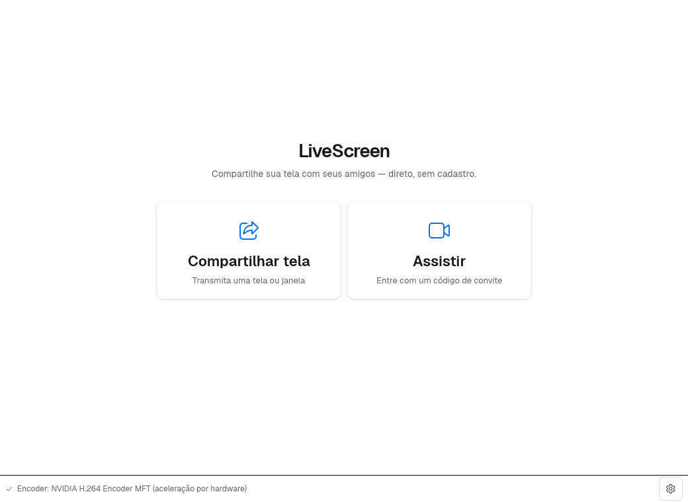
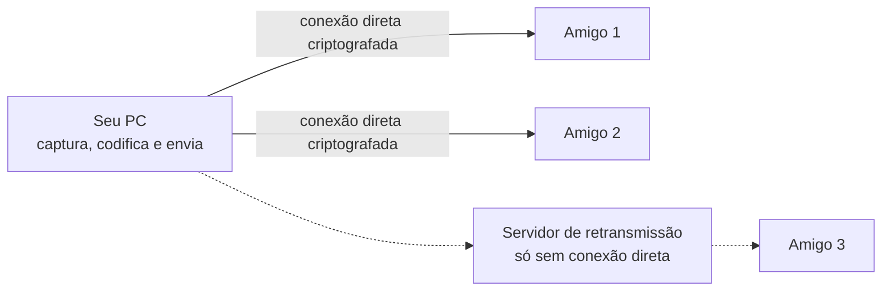
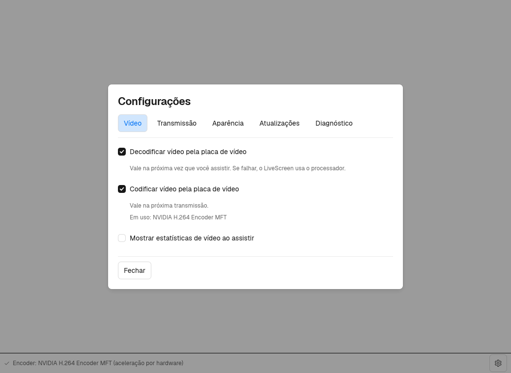

<div align="center">


# LiveScreen

**Compartilhe a tela do Windows com seus amigos, direto de um PC para o outro.**<br>
Sem cadastro e sem servidor de vídeo no meio: quem assiste só precisa do LiveScreen e de um código de convite.

[](https://github.com/pendiego/LiveScreen/releases/latest)
[](https://github.com/pendiego/LiveScreen/actions/workflows/ci.yml)

[](#licença)

**[Baixar o livescreen.exe](https://github.com/pendiego/LiveScreen/releases/latest/download/livescreen.exe)** · [todas as versões](https://github.com/pendiego/LiveScreen/releases)

<picture>
  <source media="(prefers-color-scheme: dark)" srcset="docs/screenshots/home-dark.png">
  
</picture>

</div>

## Como usar

<table>
<tr>
<th width="50%">Para compartilhar</th>
<th width="50%">Para assistir</th>
</tr>
<tr>
<td valign="top">

1. Clique em **Compartilhar tela**.
2. Clique na tela ou janela que quer mostrar.
3. Confira a qualidade e o áudio no popup e clique em **Iniciar transmissão**.
4. O código de convite já vai para a área de transferência: cole (Ctrl+V) no chat para quem vai assistir.

</td>
<td valign="top">

1. Copie o código que recebeu.
2. Clique em **Assistir**: o código já entra preenchido.
3. Clique em **Conectar**.

</td>
</tr>
</table>

Durante a transmissão dá para trocar a qualidade, mudar o limite de pessoas da sala e remover alguém sem derrubar os outros. A janela do LiveScreen some da própria transmissão, então ela não aparece para quem assiste.

## Como funciona



Cada pessoa que assiste recebe do seu PC a própria cópia do vídeo e do áudio. Quando a conexão direta não é possível, os pacotes passam por um servidor de retransmissão, que só repassa dados criptografados de ponta a ponta.

## Qualidade, sala e internet

Quem limita o tamanho da sala é o **upload** da sua internet:

| Qualidade | Upload por pessoa (máximo, com muito movimento) |
|---|---|
| 480p 30fps | 1,5 Mbps |
| 720p 30fps | 4 Mbps |
| 1080p 60fps | 8 Mbps |

> [!TIP]
> Telas paradas (slides, código, navegador) gastam bem menos que isso.

Para ajudar na escolha:

- **Upload medido:** ao abrir a escolha de tela, o app mede o seu upload (~5 s) e mostra quantas pessoas cada qualidade aguenta.
- **Qualidade recomendada:** o app marca a mais pesada que o seu PC e a sua internet sustentam para o tamanho da sala, até 1080p 60fps.
- **Limite da sala:** começa em 4 pessoas e pode ser aumentado durante a transmissão. Se o limite passar do que a internet aguenta, aparece um aviso. Quem tenta entrar com a sala cheia recebe "Recusado: sala cheia".
- **Opções conforme a fonte:** só aparecem as que cabem na tela ou janela escolhida. Por enquanto a transmissão vai até 1080p 60fps, mesmo em monitores maiores ou acima de 60 Hz.
- **Aviso de PC sobrecarregado:** se o computador não der conta da qualidade, o app avisa e sugere uma mais leve.

## Recursos

| Recurso | Como funciona |
|---|---|
| **Captura** | Windows Graphics Capture, de tela inteira ou janela. Para telas inteiras, há fallback para DXGI Desktop Duplication, que no Windows 10 é o padrão para telas (sem a borda amarela do WGC) e desenha o cursor. |
| **Vídeo** | Codificação H.264 pela placa de vídeo (NVIDIA, AMD ou Intel, via Media Foundation), com fallback para codificação por software. Limitado ao H.264 nível 5.2: lado de até 4096 px, e a "Nativa" é reduzida quando passa disso. Telas ultrawide e em pé mantêm a área de imagem da qualidade escolhida, sem virar faixa fina. |
| **Áudio** | Opus, com todo o som do computador (tela) ou só o do aplicativo (janela), e o microfone opcional (desligado por padrão, com escolha do dispositivo ao iniciar), mixados num só stream. |
| **Conexão** | Direta entre os PCs via [iroh](https://iroh.computer), com servidor de retransmissão quando a conexão direta não é possível. A conexão é criptografada de ponta a ponta. |
| **Rede** | Controle de congestionamento BBR e bitrate adaptativo: quando a fila de algum espectador cresce, o bitrate cai na hora e volta aos poucos até o teto da qualidade. Vídeo atrasado é descartado em vez de acumular. |
| **Atualização** | Pelo próprio app, com conferência do arquivo baixado. |
| **Interface** | Visual no estilo Vercel/Geist, com fonte Geist embutida, tema claro e escuro (ou seguindo o Windows), anel de foco azul para navegar pelo teclado e nomes acessíveis nos botões só com ícone. Quando as animações estão desligadas no Windows, o app desativa as animações de transição e de rolagem; os indicadores de carregamento continuam girando. |

## Configurações

Abra pela engrenagem em qualquer tela ou com `Ctrl+,`: decodificar e codificar pela placa de vídeo, estatísticas de vídeo ao assistir (overlay com fps e ms por quadro), qualidade e áudio padrão, limite da sala, nome, tema, verificação de atualização e backends de captura. Tudo fica em `ui.json`.

<div align="center">
<picture>
  <source media="(prefers-color-scheme: dark)" srcset="docs/screenshots/settings-dark.png">
  
</picture>
</div>

**Qualidade pelo espectador:** quem assiste pode pedir ao host uma qualidade mais leve (menu "Qualidade"). O host só aplica se o stream de fato ficar mais leve (largura, altura, fps e bitrate não sobem), no máximo um pedido a cada 5 s, e vale para a sala toda.

## Requisitos

- Windows 10 versão 2004 ou superior, 64 bits, para quem transmite e para quem assiste.
- Todos precisam estar na mesma versão do LiveScreen. Versões com protocolos diferentes recusam a conexão com "versão incompatível".

## Download e atualização

Baixe o `livescreen.exe` (ou o `.zip`) em [Releases](https://github.com/pendiego/LiveScreen/releases). Não precisa instalar: é só abrir.

Ao abrir, o app verifica se há versão nova. Se houver, aparece o botão **Atualizar para a versão X** no rodapé da tela inicial. Ele:

1. baixa o `livescreen.exe` da release;
2. confere o sha256 publicado pelo GitHub;
3. troca o executável e reabre o app.

> [!NOTE]
> Para atualizar, o executável precisa estar numa pasta com permissão de escrita (fora de `Program Files`, por exemplo).

## Conexões que o app faz

| Destino | Quando | Para quê |
|---|---|---|
| Servidores públicos da n0 (equipe do iroh) | ao transmitir e ao assistir | Encontrar o outro PC e retransmitir quando não há conexão direta. Os servidores repassam pacotes criptografados e não veem o vídeo. |
| `api.github.com` / `github.com` | ao abrir o app; ao clicar em Atualizar | Verificar e baixar versões novas |
| `speed.cloudflare.com` | ao abrir a escolha de tela, uma vez por execução, e ao clicar em "Medir de novo" | Medir o upload. O teste dura ~5 s e envia dados de teste: cerca de 60 MB numa fibra de 100 Mbps, com teto de 150 MB. |

## Avançado

<details>
<summary><b>Arquivos em <code>%APPDATA%\LiveScreen\</code> e <code>config.json</code></b></summary>

- **`ui.json`:** preferências (qualidade, áudio, nome, volume, limite da sala, posição da janela, decodificação/codificação por hardware, estatísticas, tema, atualização, backends de captura).
- **`livescreen.log`:** registro para diagnóstico.
- **`config.json`** (opcional): desliga partes da captura ou do encoder para contornar problemas de driver:

  ```json
  { "capture_overrides": ["deny-hardware-encoder"] }
  ```

  Os valores aceitos são `deny-graphics-capture`, `deny-dxgi`, `deny-hardware-encoder` e `deny-hardware-decoder`. A variável de ambiente `LIVESCREEN_CAPTURE_OVERRIDES` (valores separados por vírgula) substitui o arquivo. O que o arquivo ou a variável desligam não pode ser religado em Configurações.

</details>

<details>
<summary><b>Diagnóstico pela linha de comando</b></summary>

O `.exe` é um app de janela: para ver a saída, redirecione, ex.: `livescreen.exe --probe-encoder | Out-String` no PowerShell ou `| more` no cmd.

- `livescreen.exe --probe-encoder`: testa os encoders de placa e imprime o que funcionou;
- `livescreen.exe --selftest-capture`: captura a tela principal por 3 s com cada backend e conta os quadros.

</details>

<details>
<summary><b>Compilar</b></summary>

Requisitos: Rust estável (edição 2024), toolchain MSVC e CMake no `PATH` (usado para compilar o Opus).

```powershell
cargo build --release
.\target\release\livescreen.exe
```

O `build.rs` embute o ícone no `.exe` sem precisar de `rc.exe`.

</details>

<details>
<summary><b>Testes</b></summary>

```powershell
cargo test
```

Testes manuais (`#[ignore]`), que usam GPU e janelas reais:

```powershell
cargo test --release codec_roundtrip -- --ignored --nocapture   # codifica e decodifica na GPU
cargo test --release e2e_window -- --ignored --nocapture        # transmite uma janela tkinter; exige python com tkinter no PATH
```

</details>

## Licença

Dual: [MIT](LICENSE-MIT) ou [Apache-2.0](LICENSE-APACHE), à sua escolha.

A fonte [Geist](https://github.com/vercel/geist-font) (Geist Sans e Geist Mono), embutida no `.exe`, é distribuída sob a [SIL Open Font License 1.1](assets/fonts/OFL.txt).
